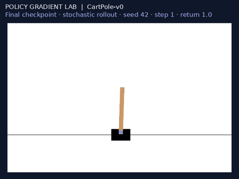
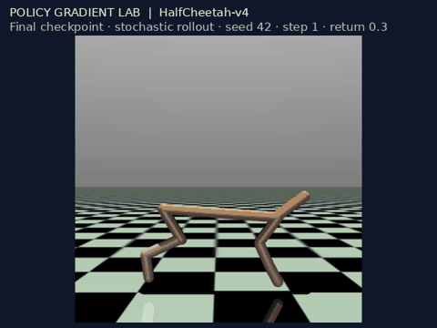
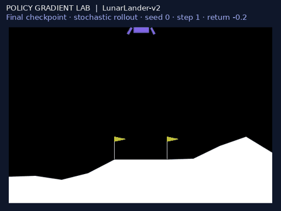
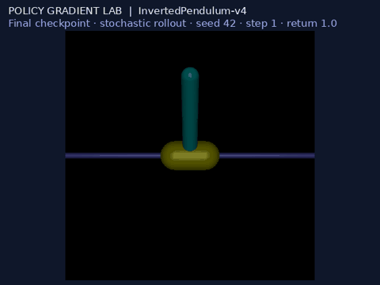

# Policy Gradient Lab

**Learning control with REINFORCE, value baselines, and generalized advantage estimation.**

A PyTorch reinforcement learning study with **24 recorded training runs across
four environments**, held-out policy evaluation, real rollout videos, and a
validated fix for a legacy simulator performance bug. Built from the
[Berkeley CS285 Spring 2026 policy gradient assignment](hw2.pdf).

## Measured results

Selected final checkpoints, each evaluated on **30 fresh stochastic episodes**.
Values are mean ± sample standard deviation; all selected policies use training
seed 1. These describe episode variation, not uncertainty across training seeds.

| Environment | Policy configuration | Fresh-episode return | Evidence |
|---|---|---:|---|
| CartPole-v0 | Normalized trajectory returns | **200.0 ± 0.0 / 200** | [30 episodes](docs/evaluation/cartpole.json) |
| HalfCheetah-v4 | Reward-to-go + value baseline, original PyTorch sampler | **409.0 ± 55.9** | [30 episodes](docs/evaluation/cheetah_reference.json) |
| LunarLander-v2 | GAE, λ = 0.99 | **120.0 ± 143.7** | [30 episodes](docs/evaluation/lunar.json) |
| InvertedPendulum-v4 | Small batches + normalized GAE | **949.8 ± 199.2 / 1,000** | [30 episodes](docs/evaluation/pendulum.json) |

- **Sample efficiency:** the stable Pendulum configuration first reached return
  1,000 at **36,372 training steps** and finished training after **73,468** steps.
  A faster, less stable candidate crossed at 26,939; the default crossed at 431,837.
- **Variance matters:** LunarLander peaked at 236.4 during training-time evaluation
  and finished at 227.6, but its fresh-episode mean was 120.0. Peaks alone overstate
  reliability. All unsuccessful configurations remain in the results.
- **Baseline comparison:** the original-sampler unnormalized HalfCheetah baseline
  finished at 374.2; three NumPy-sampler seeds finished below 300. The optional
  normalized baseline averaged 354.5 over fresh episodes. Sampler RNG streams,
  seeds, and exact flags are recorded rather than treated as interchangeable.

[Full results and assignment answers](docs/RESULTS.md) · [PDF report](docs/report.pdf)
· [Exact commands](docs/commands.sh) · [Raw experiment artifacts](exp/)

## Policy demonstrations

Short GIF previews of frozen final policies; MP4 links contain complete episodes.
An individual rollout does not establish average performance.

| CartPole | HalfCheetah — unnormalized baseline |
|---|---|
|  |  |
| [Full video](media/cartpole_demo.mp4) | [Full video](media/cheetah_reference_demo.mp4) |

| LunarLander — selected successful example | InvertedPendulum — stable small-batch policy |
|---|---|
|  |  |
| [Full video](media/lunar_demo.mp4) | [Full video](media/pendulum_demo.mp4) |

The LunarLander success is explicitly selected for illustration; its
[selection log](docs/demo_selection.json), [original seed-42 failure](media/lunar_seed42.mp4),
and all 30 evaluation outcomes are retained. The optional normalized HalfCheetah
controller also has a [GIF](media/cheetah_demo.gif) and [full video](media/cheetah_demo.mp4).

## What is implemented

- **Policy learning:** categorical and diagonal Gaussian MLP policies, discounted
  trajectory returns, reward-to-go, advantage normalization, learned value
  baselines, and GAE. Gradient updates use PyTorch; CPU rollouts can use a tested
  NumPy inference path.
- **Simulator engineering:** removed decorative exhaust accumulation in headless
  LunarLander, measuring **16.4× faster environment stepping** on a long-hover
  microbenchmark. State/reward/termination traces matched exactly over 5,000
  comparison steps; learning metrics matched across **437 paired iterations**.
  This is a simulator speedup, not an end-to-end training speedup.
- **Reproducibility:** locked CPU dependencies, explicit RNG/backend settings,
  separate evaluation environments, CSV metrics, model checkpoints, and source
  provenance. The final model files contain parameters, not resumable optimizer state.
- **Verification:** 16 correctness tests covering return arithmetic, GAE boundaries,
  probability gradients, value regression, rollout budgets, inference equivalence,
  and simulator equivalence; local logging and automated GitHub checks.

[Algorithm notes](docs/ALGORITHMS.md) · [Source and protocol](docs/PROVENANCE.md)
· [Runtime benchmark](docs/lunar_runtime.json) · [Training equivalence](docs/lunar_prefix_equivalence.json)

## Quick start

Tested on Linux x86_64 with Python 3.10, [uv](https://docs.astral.sh/uv/),
and a C/C++ compiler for Box2D. The build configuration supplies SWIG; PyTorch uses
CPU wheels. Training requires no cloud account or API key.

```bash
uv sync --locked
uv run pytest -q
OPENBLAS_NUM_THREADS=1 uv run src/scripts/run.py --env_name CartPole-v0 \
  -n 100 -b 1000 -rtg -na --exp_name cartpole_rtg_na \
  --no_gpu --rollout_backend numpy
```

Run or resume the experiment matrix, regenerate analysis, and build the assignment archive:

```bash
uv run python scripts/experiments.py --workers 4 --notify
uv run python scripts/status.py
uv run python scripts/analyze.py
uv run python scripts/package_submission.py
```

The runner skips completed configurations, prevents duplicate jobs, and adopts
matching live processes after an orchestrator restart. The archive contains code,
logs, checkpoints, evaluation evidence, and the PDF report; videos live in `media/`.
See the [development guide](docs/DEVELOPMENT.md) for rendering and operational details.

## Repository map

```text
src/agents/pg_agent.py       Return estimators, advantages, actor/critic updates
src/networks/               Categorical/Gaussian policies and value regression
src/infrastructure/         Rollouts, simulator compatibility, logging, notifications
src/scripts/run.py          Assignment-compatible training CLI
scripts/                    Experiment orchestration, evaluation, plots, media, packaging
exp/                        Versioned metrics, flags, provenance and model parameters
media/                      Learning curves, GIF previews and full policy videos
tests/                      Numerical and simulator regression checks
docs/                       Results, PDF report, algorithms and reproduction protocol
```

## Optional integrations

For Discord, set `DISCORD_WEBHOOK_URL` in the ignored `.env` file using
[.env.example](.env.example). `--notify` posts run summaries and exported media.
Credentials are excluded from Git and submission archives.

For Weights & Biases, install `uv sync --extra tracking` and pass
`--wandb_mode online` or `offline`. Local-only logging is the default.

## Attribution

Extends the [official Berkeley Spring 2026 HW2 starter](https://github.com/berkeleydeeprlcourse/homework_spring2026/tree/main/hw2).
The original file structure is preserved; this repository completes the learning
implementations and adds experiment automation, performance engineering,
validation, reporting, and media export. See [PROVENANCE.md](docs/PROVENANCE.md).
