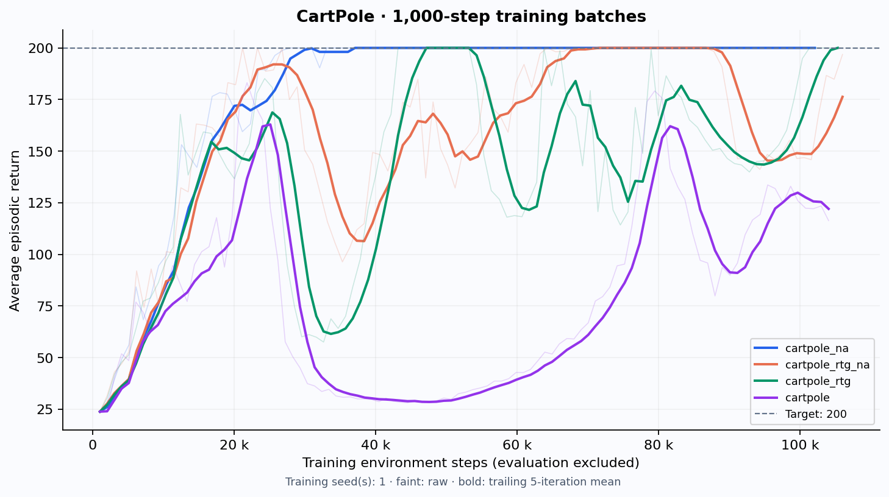
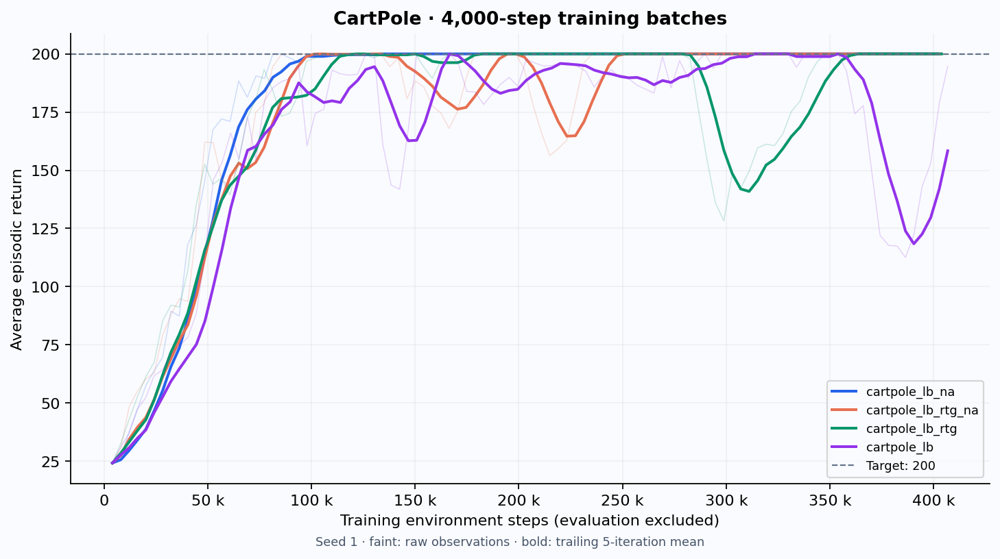
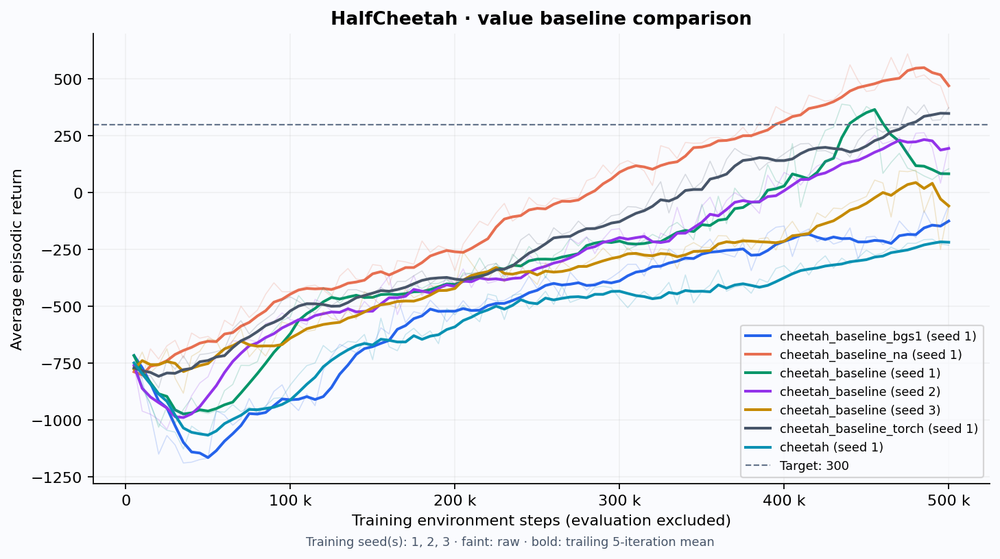
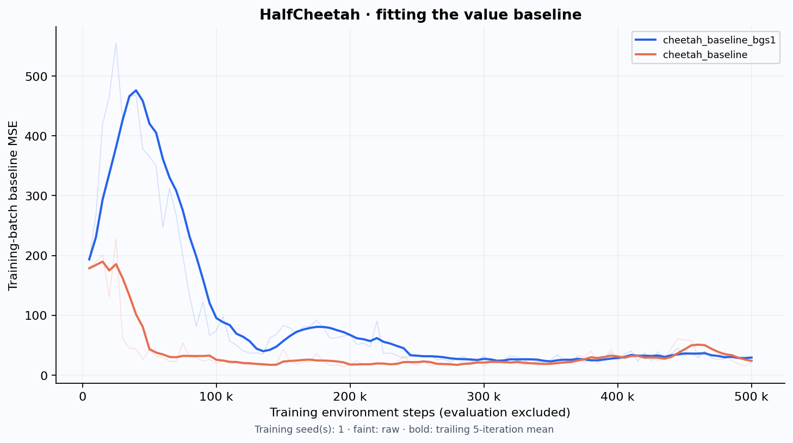
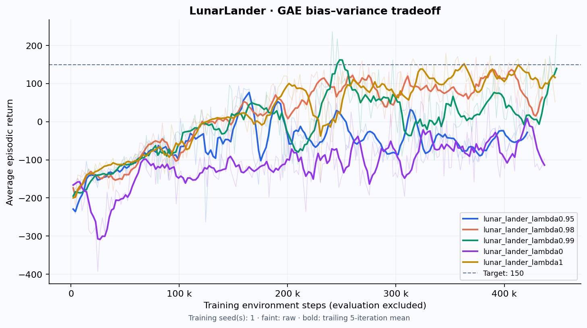
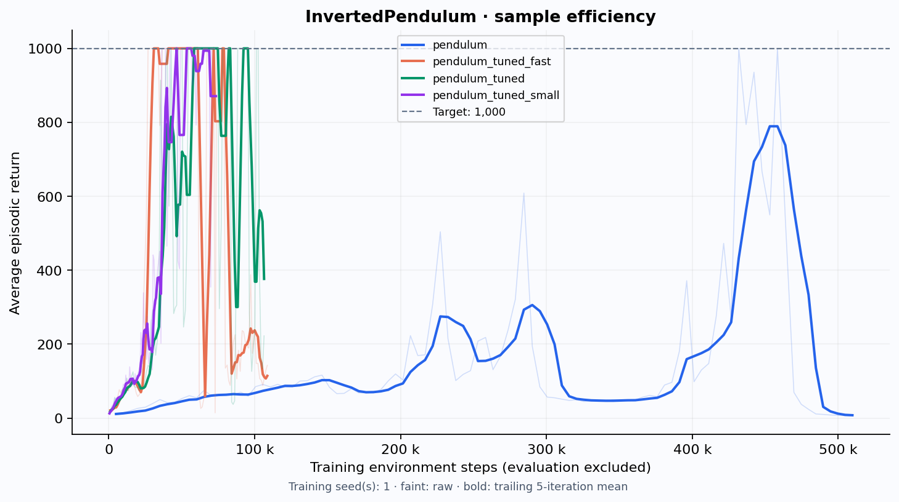

# Experimental results

Generated from completed run CSVs by `uv run python scripts/analyze.py`.

All primary ablations use **seed 1**. Peak return is the best single evaluation batch; final and trailing-ten means are also reported to expose instability. Evaluation samples are stochastic and limited; these are not confidence intervals or multi-seed guarantees.

| Experiment | Peak eval | Final eval | Last 10 mean | Training steps | First target steps |
|---|---:|---:|---:|---:|---:|
| [cartpole_lb_na](../exp/CartPole-v0_cartpole_lb_na_sd1_20261019_165747/log.csv) | 200.0 | 200.0 | 200.0 | 401,861 | 44,274 |
| [cartpole_lb_rtg_na](../exp/CartPole-v0_cartpole_lb_rtg_na_sd1_20261019_170021/log.csv) | 200.0 | 200.0 | 200.0 | 403,417 | 69,020 |
| [cartpole_lb_rtg](../exp/CartPole-v0_cartpole_lb_rtg_sd1_20261019_165513/log.csv) | 200.0 | 200.0 | 200.0 | 403,846 | 73,115 |
| [cartpole_lb](../exp/CartPole-v0_cartpole_lb_sd1_20261019_165237/log.csv) | 200.0 | 200.0 | 165.0 | 406,820 | 77,340 |
| [cartpole_na](../exp/CartPole-v0_cartpole_na_sd1_20261019_165027/log.csv) | 200.0 | 200.0 | 200.0 | 102,080 | 21,151 |
| [cartpole_rtg_na](../exp/CartPole-v0_cartpole_rtg_na_sd1_20261019_165125/log.csv) | 200.0 | 200.0 | 165.5 | 105,992 | 18,004 |
| [cartpole_rtg](../exp/CartPole-v0_cartpole_rtg_sd1_20261019_164922/log.csv) | 200.0 | 200.0 | 186.7 | 105,319 | 41,159 |
| [cartpole](../exp/CartPole-v0_cartpole_sd1_20261019_164817/log.csv) | 200.0 | 122.0 | 126.3 | 104,024 | 20,711 |

Targets: CartPole 200; HalfCheetah 300; LunarLander 150; InvertedPendulum 1,000.

## 1. CartPole: returns, normalization and batch size

**Small batch (1,000).** Last-ten mean evaluation returns: trajectory 126.3, reward-to-go 186.7, normalized trajectory 200.0, normalized reward-to-go 165.5. Without normalization, reward-to-go performed better by this endpoint metric.

Normalization changed the trajectory last-ten evaluation mean by +73.7 points.

Normalization changed the reward-to-go last-ten evaluation mean by -21.2 points.

**Large batch (4,000).** Last-ten mean evaluation returns: trajectory 165.0, reward-to-go 200.0, normalized trajectory 200.0, normalized reward-to-go 200.0. Without normalization, reward-to-go performed better by this endpoint metric.

Normalization changed the trajectory last-ten evaluation mean by +35.0 points.

Normalization changed the reward-to-go last-ten evaluation mean by +0.0 points.

With normalized reward-to-go, increasing the batch changed the last-ten mean from 165.5 to 200.0. The first 200-return evaluations occurred at 18004 and 69020 training steps respectively (None means never reached).

Reward-to-go is generally preferred because an action cannot influence past rewards. Removing those past terms preserves the expected score-function gradient while usually reducing its variance. Relative discounting weights future rewards from each decision.

Normalization rescales the update and subtracts a batch mean; it is a useful heuristic but introduces finite-batch bias. Compare normalized and unnormalized rows above rather than assuming it always helps. Batch size trades gradient noise against interaction cost: 100 iterations at 4,000 steps use roughly four times the data of 1,000-step batches. The charts compare actual training steps, not iteration counts. CartPole plots show training-batch average return, as in the assignment; the comparison table uses evaluation return.

## 2. HalfCheetah: learned baseline

The one-gradient-step ablation keeps the baseline learning rate at 0.01 and reduces value updates from five to one. This slows fitting to the current batch; policy outcomes above show whether that change helped this seed. Value targets change with the policy, so training MSE need not decrease monotonically, and lower training MSE alone does not prove better control. The baseline uses raw targets.

## 3. LunarLander: generalized advantage estimation

λ=0 uses one-step TD residuals, reducing variance while depending heavily on value accuracy. λ=1 telescopes to Monte Carlo reward-to-go minus the baseline under the zero-tail boundary convention, reducing bootstrap bias while increasing variance. Intermediate λ mixes horizons. The observed ranking above and curves below reflect this seed, not a universal monotonic relationship. All five runs retain the PDF’s fixed batch size, learning rate, architecture, discount, and iteration budget.

The official starter uses standard LunarLander-v2 without an additional action-noise wrapper; this protocol is preserved. See [PROVENANCE.md](PROVENANCE.md).

## 4. InvertedPendulum: sample efficiency

No completed run has reached the 1,000-return target yet.

Tuning reduces batches from 5,000 to 500 or 1,000 transitions to allow more frequent policy updates per interaction budget, and combines reward-to-go, normalization, a value baseline, γ=0.99 and GAE. The candidates also vary learning rate and λ. These coupled changes are a configuration search, not a controlled causal attribution of gains to any one hyperparameter. All attempts are retained.

## Reproduction and limitations

Exact command lines are in [commands.sh](commands.sh); per-run flags and source revision are beside each CSV. The eight CartPole, three HalfCheetah, five LunarLander, and four InvertedPendulum configurations are generated by `scripts/experiments.py`.

Single-seed comparisons and peak selection can be optimistic. A larger study should repeat every setting over independent seeds and evaluate saved policies over many held-out episodes. Training steps exclude evaluation interactions as required by the assignment. Time-limit tails are zero, not bootstrapped. Videos show individual rollouts of final checkpoints and do not establish average performance.

## Fresh-episode evaluation of selected final checkpoints

Configurations are selected from the benchmark comparisons. Each frozen final policy is then evaluated stochastically on 30 new, individually seeded episodes. These bootstrap intervals measure episode variation for one trained policy, not training-seed uncertainty.

| Selected policy | Episodes | Mean return | Standard deviation | Bootstrap 95% CI |
|---|---:|---:|---:|---| 
| [cartpole_na](evaluation/cartpole.json) | 30 | 200.0 | 0.0 | [200.0, 200.0] |
